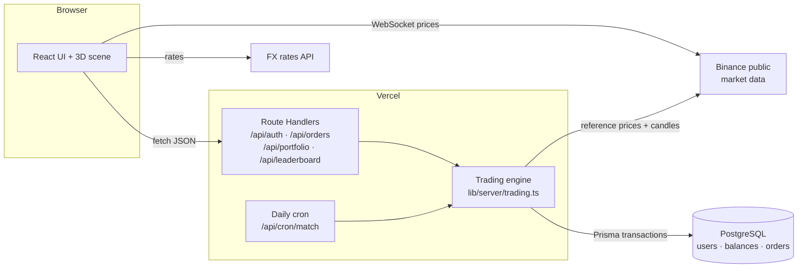

# VaultX: 3D Crypto Paper-Trading Exchange

A full-stack, exchange-style trading app with **live Binance market data**, a **procedural 3D scene**, and a **server-side paper-trading engine**: accounts, balances, market and limit orders, and a public leaderboard.

> **Paper trading only.** No real money, deposits or withdrawals. Every account starts with 25,000 USDT of virtual funds.

**Live demo:** https://vaultx-exchange.vercel.app

---

## Features

- **Live market data**: real-time prices for BTC, ETH, SOL, BNB, XRP and DOGE over WebSockets, with automatic reconnect (exponential backoff) and a simulated feed if the connection drops
- **Trading engine**: market and limit orders, executed on the server against live prices
  - Limit orders lock funds (`free` / `locked` balances) and fill once the market trades through the limit price
  - Orders that cross the market on placement fill right away at the better of the limit and market price
  - Balance updates are **atomic conditional writes inside transactions**, so concurrent requests can't overspend or double-fill
- **Accounts**: sign up / log in with bcrypt-hashed passwords and signed JWT sessions in `httpOnly` cookies
- **Leaderboard**: traders ranked by live portfolio value and P&L
- **Multi-currency display**: USD, MNT (₮), EUR, KRW, CNY, JPY using live FX rates
- **3D scene**: procedural metallic coin emblem (React Three Fiber, no model files) that changes color per coin and reacts to price ticks
- **Canvas chart**: a hand-written HTML5 canvas chart with HiDPI support, a crosshair tooltip and a last-price marker

## Tech stack

| Layer    | Tech |
| -------- | ---- |
| Frontend | Next.js 16 (App Router), React 19, TypeScript, Tailwind CSS 4 |
| 3D       | three.js, @react-three/fiber, @react-three/drei |
| Backend  | Next.js Route Handlers, Prisma 6, PostgreSQL |
| Auth     | bcryptjs, jose (HS256 JWT), zod validation |
| Testing  | Vitest (matching engine), end-to-end API smoke test |
| Infra    | Vercel (app + daily cron), Neon Postgres, Docker Compose for local DB |

## Architecture



### How limit orders fill

There's no always-on matching process (serverless functions don't run in the background), so matching is **lazy**:

1. When a user's portfolio or the leaderboard is requested (and once a day via cron), the engine loads open limit orders.
2. For each symbol it fetches candles since the oldest order. Resolution goes from 1m to 1h to 1d as orders get older, so one request is always enough.
3. An order fills if the market traded through its limit **after it was placed**. Candles that opened before the order are ignored.
4. Each fill is a transaction guarded by `UPDATE … WHERE status = 'OPEN'`, so a fill and a cancel racing each other can't both succeed.

The rules are pure functions in [`lib/server/matching.ts`](lib/server/matching.ts) with unit tests in [`matching.test.ts`](lib/server/matching.test.ts).

## API

| Method | Route | Description |
| ------ | ----- | ----------- |
| `POST` | `/api/auth/register` | Create an account (starts with 25,000 USDT) |
| `POST` | `/api/auth/login` | Log in, sets the session cookie |
| `POST` | `/api/auth/logout` | Clear the session |
| `GET` | `/api/portfolio` | Balances, open orders, history (`{ user: null }` when logged out) |
| `POST` | `/api/orders` | Place an order `{ symbol, side, type, amount, price? }` |
| `DELETE` | `/api/orders/:id` | Cancel an open order and release locked funds |
| `GET` | `/api/leaderboard` | Top traders by portfolio value |
| `GET` | `/api/cron/match` | Fill crossed limit orders (requires `CRON_SECRET`) |

## Running locally

Requires Node 20+ and Docker.

```bash
npm install
cp .env.example .env        # then set AUTH_SECRET (openssl rand -hex 32)
npm run db:up               # Postgres on localhost:5435
npm run db:migrate          # apply migrations
npm run dev                 # http://localhost:3000
npm test                    # unit tests
```

## Project structure

```
app/
  page.tsx                 trading dashboard
  leaderboard/page.tsx     leaderboard
  api/…                    route handlers
components/                OrderBook, LiveChart, TradePanel, CryptoScene3D, AuthDialog
hooks/                     live tickers, FX rates, portfolio
lib/
  pairs.ts, currencies.ts  shared config
  server/                  db, session, market data, trading engine, matching rules
prisma/                    schema + migrations
```

## Security notes

- Passwords are hashed with bcrypt (cost 12). Login takes the same time whether or not the username exists.
- Sessions are HS256 JWTs in `httpOnly`, `SameSite=Lax`, `Secure` cookies. State-changing requests from other origins are rejected.
- All input is validated with zod. Limit prices more than 50% away from the market are rejected.
- Rate limiting is per instance and best effort. A production system would use a shared store such as Redis.
